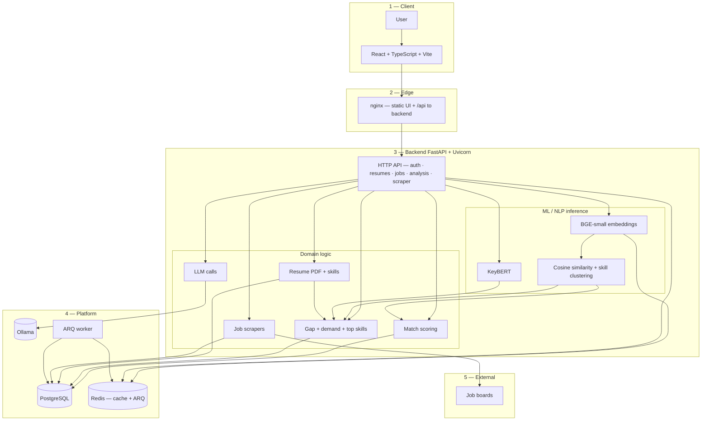

# CareerFit AI — Big-picture architecture (single view)

One diagram for reports, thesis, and stakeholder decks. Export from [mermaid.live](https://mermaid.live) as PNG/SVG for PowerPoint.

---

## Full-stack + ML + data (one flowchart)

**Read top → bottom:** experience → API → intelligence → persistence → background → external data.



## Captured architecture image


---

## Same story in five bullets (speaker script)

1. **Users** hit the **React** app; **nginx** serves the UI and forwards **`/api`** to **FastAPI**.
2. **Inference:** **BGE** vectors + **KeyBERT** phrases + **similarity** feed **match** and **gap** services.
3. **State** lives in **PostgreSQL**; **Redis** backs **embedding cache** and **ARQ** queues.
4. **Ollama** answers structured LLM calls (skill cleanup, gap/match advice) over HTTP.
5. **Scrapers** pull **job postings** from external boards; the **worker** can run heavy gap/scrape jobs asynchronously.

---

## Simplified block diagram (ASCII)

```
┌─────────────┐     ┌───────┐     ┌──────────────────────────────────────────┐
│   Browser   │────▶│ nginx │────▶│ FastAPI                                   │
│  React SPA  │     │ :80   │     │  routers → services (ML + business)     │
└─────────────┘     └───────┘     └───────┬───────────────┬─────────────────┘
                                          │               │
                    ┌─────────────────────┼───────────────┼─────────────────┐
                    ▼                     ▼               ▼                 ▼
              ┌───────────┐         ┌─────────┐   ┌───────────┐     ┌──────────┐
              │ PostgreSQL │         │  Redis  │   │  Ollama   │     │ Job board│
              │  primary   │         │cache+ARQ│   │ local LLM │     │ adapters │
              └───────────┘         └────┬────┘   └───────────┘     └──────────┘
                                         │
                                    ┌────▼────┐
                                    │ARQ worker│
                                    └─────────┘
```

---

*Aligned with `backend/app/` — routers, `embedding_service`, `skill_service`, `match_service`, `gap_service`, `resume_service`, `scraper_service`, `llm_service`, Redis cache, ARQ `worker/`.*
