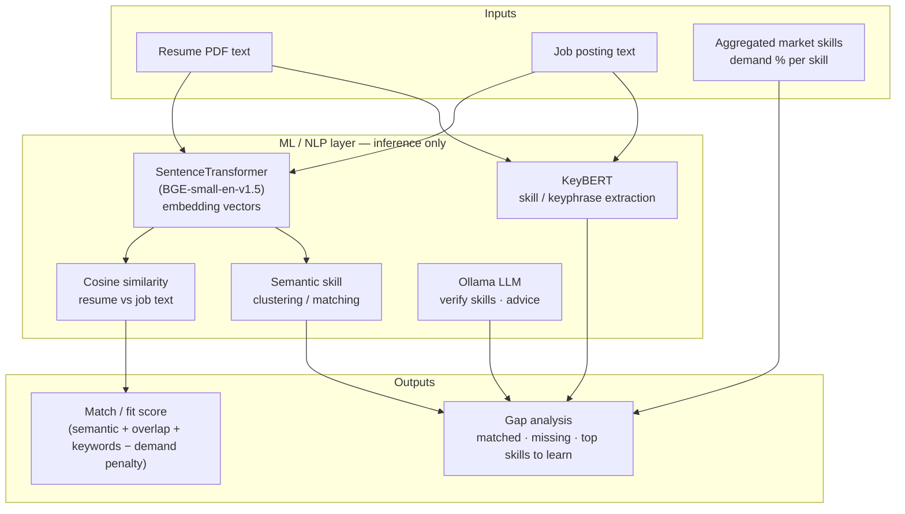
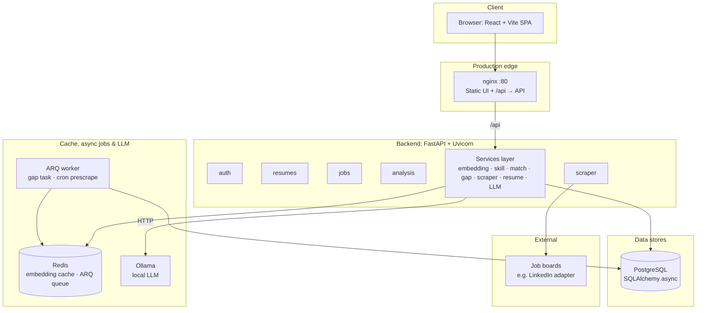

# CareerFit AI — Product deck (15 slides)

Use this file as the single source of truth for titles and bullets. Paste slide-by-slide into PowerPoint / Google Slides. Replace `[screenshot]` with real UI captures. Adjust supervisor names and author on slide 1.

**Design notes:** One idea per slide; keep bullets to 4–6 lines; use your “Cream and Pink Leaves” theme for consistency.

---

## Slide 1 — Title

**CareerFit AI**  
*Explainable resume–market fit with demand-weighted skill gaps*

- Full-stack AI product: PDF resume → skills → live market → prioritized learning
- **[Author name, ID, program]**  
- **Supervisors:** [Dr. B. Bhaskara Rao] · [Ms. R. Arshiya]

**Speaker note:** One sentence: we help candidates see what the market asks for that their resume doesn’t show—and what to learn first.

---

## Slide 2 — The problem

**Hiring and upskilling are noisy**

- Keyword matchers miss **meaning** (same skill, different wording).
- Pure semantic scores rarely reflect **which missing skills matter in the market**.
- Candidates get **generic** feedback—not **what to learn next** ranked by demand.
- Recruiters and trainers lack a **repeatable, explainable** view of skill gaps at scale.

**Speaker note:** Position as “decision quality,” not just automation.

---

## Slide 3 — Product vision

**One place to align a resume with real job demand**

- **Fit score** that combines language similarity, skill overlap, keywords, and **market demand**.
- **Transparent breakdown** so users trust the number—not a black box.
- **Actionable output:** missing skills, high-impact “top skills to learn,” and **LLM-based** coaching (Ollama).
- Built as a **web product** (dashboard), not a one-off script.

---

## Slide 4 — Who it’s for

**Primary users**

| User | Value |
|------|--------|
| **Job seekers** | See gaps vs target role; prioritize learning; improve resume language. |
| **Universities / placement** | Batch-agnostic narrative: focus training on high-demand gaps. |
| **Recruiters / talent teams** | *(Future)* Structured skill signals to complement ATS keywords. |

**Speaker note:** Emphasize job seeker + placement; enterprise is optional future.

---

## Slide 5 — What the product does (feature set)

**Core capabilities**

- **Resume ingestion:** PDF upload → text extraction → skill extraction (KeyBERT + rules + dictionary where enabled).
- **Market view:** Job listings from configured sources; skills aggregated for **demand %** and trends.
- **Gap analysis:** Target role + experience → **market fit**, **matched / missing skills**, **demand-ranked** missing skills.
- **Job match:** Per-job score with **explainable** factors and **LLM** advice (Ollama).
- **Dashboard:** Gap results, trends, learning hints, job list—single UX.

**Include:** `[screenshot: Dashboard]`

---

## Slide 6 — User journey (happy path)

**From PDF to prioritized learning**

1. **Upload** resume (PDF) → skills stored per user/session.  
2. **Choose** target role & experience context.  
3. **Analyze gap** → pipeline pulls/refreshes market jobs as configured.  
4. **Review** fit %, missing vs matched skills, **top skills to learn** (live slice + filters + **Ollama** verification).  
5. **Act** on structured advice and job matches.

**Speaker note:** ~60 seconds to value if data is warm; longer if scrape runs.

---

## Slide 7 — Architecture: why two diagrams?

**This *is* an ML project — but “ML” here is mostly *inference*, not a separate training farm.**

| View | What it answers | Who cares |
|------|------------------|-----------|
| **A — ML / NLP pipeline** | Which models and math turn text into scores and skill lists? | ML course, thesis reviewers, “where is the AI?” |
| **B — System deployment** | Where do those models run (browser, API, DB, cache, LLM server)? | Product demo, engineering, deployment |

There is **no offline training loop** in the shipped product: we use **pretrained** embeddings (BGE), **KeyBERT** on top of the same embedding model, **cosine similarity**, **semantic skill clustering** (when enabled in settings), and a **local generative LLM** (Ollama) for verification and advice. So the **software architecture** diagram doesn’t label every box “transformer” — the **embedding_service**, **skill_service**, and **match_service** *are* the ML layer inside the backend.

**Use both figures on one slide (stacked) or split across two slides if your template needs space.**

### Figure A — ML / NLP inference pipeline (the “machine learning” story)

*Pretrained models + similarity + demand statistics + Ollama LLM. Arrows = data flow at request/analysis time.*

**One line for the panel:** *“End-to-end learning is not retrained here; we apply pretrained representations and structured demand signals to produce explainable scores.”*

### Figure B — System deployment (where the ML runs)

*Same stack as your product diagram: ML code runs **inside** the FastAPI **services** process (CPU/GPU), not in the browser.*

**Note:** Routers (`auth`, `resumes`, `jobs`, `analysis`, `scraper`) live inside the API layer and call **Svc**; the diagram uses one **`Nginx → Services`** edge for clarity. **RScr → LI** = scraper fetches external job HTML/APIs.

---

## Slide 8 — Technology stack

**Battle-tested, shippable stack**

| Layer | Choices |
|--------|---------|
| **Frontend** | React 18, TypeScript, Vite, Tailwind CSS |
| **API** | FastAPI, Uvicorn, Pydantic, slowapi rate limiting |
| **ML / NLP** | SentenceTransformers (`BAAI/bge-small-en-v1.5`), KeyBERT, cosine similarity |
| **Data** | PostgreSQL, SQLAlchemy async, asyncpg |
| **Redis & jobs** | Redis — embedding L2 cache + ARQ broker; worker for gap tasks & prescrape cron |
| **LLM** | Ollama-compatible HTTP API — summaries, advice, skill verification |
| **Ops** | systemd + nginx on VM; env-based configuration |

---

## Slide 9 — Intelligence pipeline (data flow)

**How intelligence is produced**

- **Resume path:** PDF → **pdfplumber** text → **KeyBERT** (+ normalization / blocklists) → **LLM** cleanup of skill phrases (Ollama) → persist skills.  
- **Market path:** Scraper adapters → job text → skill extraction → **demand statistics** (counts / % across postings).  
- **Gap path:** Align resume skills to **role-filtered market** skills; rank **high-demand missing** skills; **top-N live jobs** slice for “top skills to learn”; **LLM** (Ollama) keeps only technical, learnable items.  
- **Match path:** Same embedding backbone for resume vs job text + component scores.

**Speaker note:** Mention configurable geography/time window via environment—not hard-coded to one country in code.

---

## Slide 10 — Explainable match score

**Not a single opaque number**

Composite match score uses weighted components (implemented in product):

**Score ≈ 0.50 × Semantic + 0.30 × Skill overlap + 0.20 × Keyword − 0.20 × Demand penalty**

- **Semantic:** Transformer embeddings vs job text (cosine similarity).  
- **Skill overlap:** Matched vs required skills (with semantic skill clustering when enabled).  
- **Keyword:** Lexical coverage.  
- **Demand penalty:** Missing skills that are **common in postings** hurt more—drives realistic “market pain.”

Uncertainty / confidence hints where data is thin.

---

## Slide 11 — Differentiators

**Why this isn’t “ATS 2.0”**

| Theme | Benefit |
|--------|---------|
| **Demand-aware gaps** | Missing **Python** matters more if **Python** is everywhere in your slice. |
| **Explainability** | Users see **which** factors moved the score. |
| **Live market slice** | “Top skills to learn” can be grounded in **recent, role-filtered** postings. |
| **Local LLM (Ollama)** | On-premise coaching and skill verification — no mandatory cloud API. |
| **Full product** | Auth, dashboard, API, deployment path—not a notebook. |

---

## Slide 12 — Deployment & reliability

**How we run it in production**

- **Backend:** `uvicorn` behind **systemd**; configurable `DATABASE_URL`, scraper, LLM.  
- **Frontend:** Static build served by **nginx**; `/api` reverse-proxied to the API.  
- **Redis:** Embedding cache and **ARQ** queue for background gap jobs and scheduled prescrape.  
- **Observability:** Structured logging; API docs at `/docs`; metrics hook available.

**Speaker note:** Briefly mention VM deploy + re-scrape freshness—not demo infrastructure detail unless asked.

---

## Slide 13 — Honest limitations

**What the product does not claim**

- Market view is only as good as **scraped volume and freshness** (platform HTML, rate limits, duplicates).  
- **Geography and time window** are **configurable defaults**—not global labor statistics.  
- **Skill extraction** can surface noise; **heuristics + LLM verification** reduce it but don’t eliminate edge cases.  
- **LinkedIn / third-party** usage must respect **terms of service** and ethical scraping practices.

**Mitigations:** Multi-source jobs (adapters), corpus fallback, blocklists, re-analysis, configurable windows.

---

## Slide 14 — Roadmap

**Near-term product evolution**

- Broader **job sources** and **scheduled** market warming jobs.  
- Stronger **skill canonicalization** and **user feedback** loops (thumbs on suggestions).  
- **Employer mode** (shortlist explanations) — optional.  
- **Evaluation harness** (gold resumes / roles) for score quality.

---

## Slide 15 — Summary & ask

**CareerFit AI**

- **Problem:** Weak alignment between resumes and **what the market actually asks for**.  
- **Solution:** Embeddings + skill graph + **demand weighting** + transparent scoring + **Ollama** (local LLM).  
- **Delivery:** Production-style **SPA + API + DB + Redis + Ollama**, deployable behind **nginx**.

**Thank you**  
**Questions?**  
**Demo:** [live URL or “local dashboard”] · **Repo / docs:** [if allowed]

---

## Appendix — One-pager handout

- **One-liner:** Demand-aware, explainable skill-gap analysis for job seekers.  
- **Stack:** React · FastAPI · PostgreSQL · Redis · BGE embeddings · KeyBERT · Ollama · ARQ worker.  
- **Score:** 50% semantic · 30% skill overlap · 20% keywords · minus demand penalty on hot missing skills.

---

*Generated to match the repository architecture (`CLAUDE.md`, `match_service.py` weights, services layout). Update slide 1 names and any institution-specific branding before submission.*
